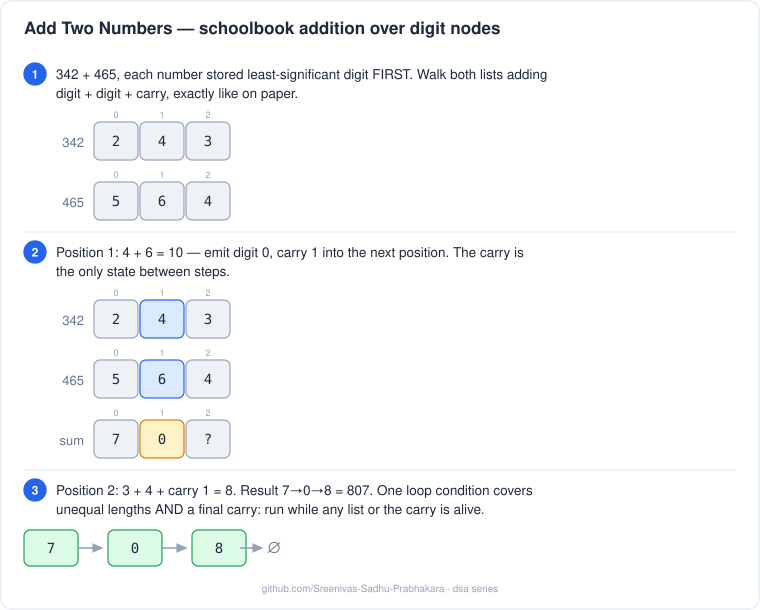

# Add Two Numbers as Linked Lists

> Striver SDE Sheet 029 · Day 5 Linked List — schoolbook addition over digit nodes; one loop condition covers both tails and the final carry. Go, stdlib only, tested.

## Problem

Two non-negative integers are stored as linked lists, least significant digit first (so 342 is `2 → 4 → 3`). Return their sum in the same representation. The numbers can be far larger than any machine integer — that's the point of the list format.

## Approach

Exactly how addition is done by hand: walk both lists together, summing digit + digit + carry, emitting `sum % 10` and carrying `sum / 10`. The clean formulation folds all the edge cases into one loop condition — `a != nil || b != nil || carry != 0` — so unequal lengths and a final carry that outlives both lists (999 + 1) need no special-case code after the loop.

**Complexity:** O(max(n, m)) time, output-sized space.

## Visual walkthrough

Read the picture top to bottom — each numbered frame is one moment of the algorithm
running on this repo's test example.

## Run

    go test ./...   # verify
    go run .        # demo

---

One of 191 repos solving Striver's SDE Sheet in Go — stdlib only, one problem per repo, every solution tested. Browse the set: [`dsa-*` repos](https://github.com/Sreenivas-Sadhu-Prabhakara?tab=repositories&q=dsa-&type=source).
